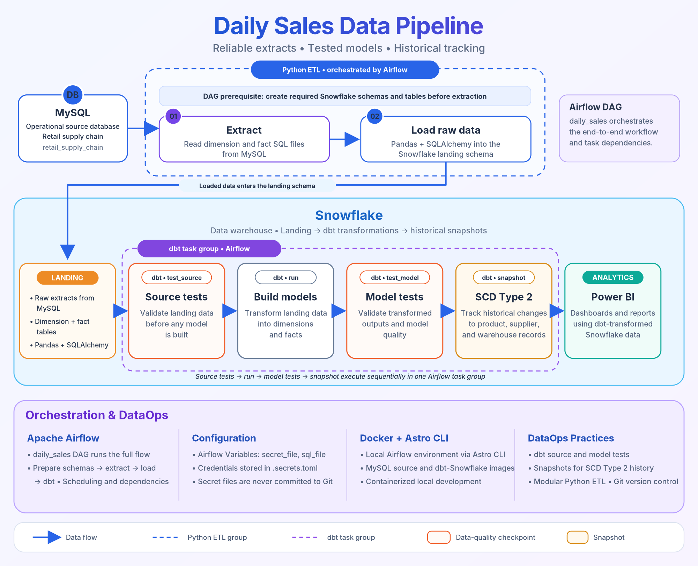
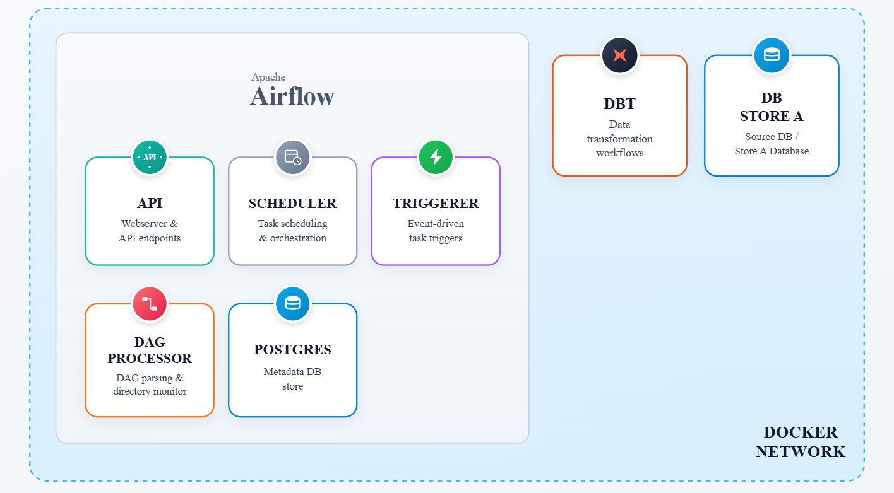
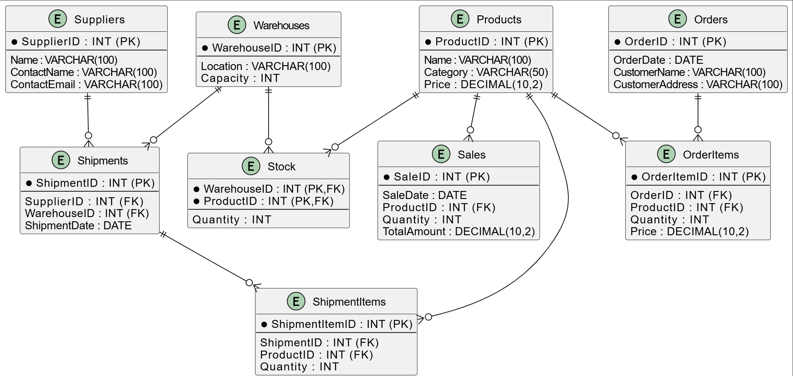
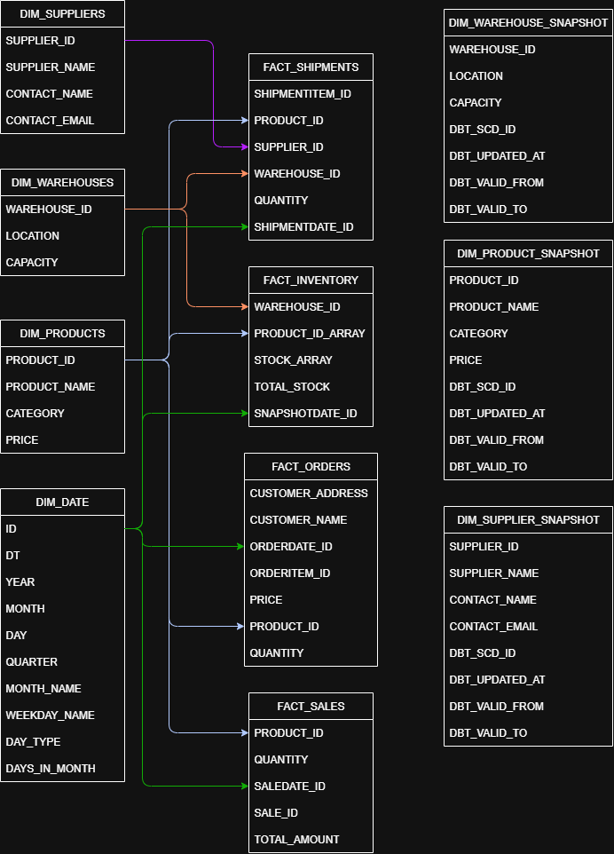

# Daily Sales Data Pipeline

An end-to-end ETL/ELT pipeline for **retail supply chain analytics**, built with Apache Airflow, Snowflake, dbt, and MySQL.

The pipeline extracts operational data from MySQL, loads it into Snowflake's landing schema, and uses dbt to transform, test, and snapshot the data for analytics.

## Table of Contents

- [Architecture](#architecture)
- [Tech Stack](#tech-stack)
- [Pipeline Workflow](#pipeline-workflow)
- [Data Model](#data-model)
- [Project Structure](#project-structure)
- [Preview](#preview)
- [Portfolio Highlights](#portfolio-highlights)
- [Installation & Running](#installation--running)

## Architecture

### Pipeline Flow



The pipeline is orchestrated by **Apache Airflow** and consists of the following stages:

1. **MySQL** — operational database containing retail supply chain data, including products, suppliers, warehouses, orders, shipments, inventory, and sales.
2. **Airflow** — schedules and orchestrates the extraction, loading, and dbt workflow.
3. **Python ETL** — extracts data from MySQL and loads it into Snowflake using Pandas and SQLAlchemy.
4. **Snowflake** — central data warehouse. Raw extracted data is loaded into the landing schema.
5. **dbt** — transforms landing data into dimensional models, runs data tests, and creates snapshots to track historical changes.

### Docker Architecture



The local development environment uses Docker to run the pipeline services. Astronomer (Astro CLI) manages the Airflow environment, while the MySQL source database and dbt execution environment provide the source and transformation components.

## Tech Stack

| Technology | Role |
|---|---|
| **Apache Airflow 2.x** | Workflow orchestration and scheduling |
| **Snowflake** | Cloud data warehouse |
| **dbt Core 1.x** | SQL transformations, data tests, and snapshots |
| **MySQL** | Operational data source |
| **Python 3.9+** | ETL development |
| **Pandas** | Data handling during extraction and loading |
| **SQLAlchemy** | Database connectivity |
| **Docker** | Containerized local environment |
| **Astronomer Astro CLI** | Local Airflow development environment |

## Pipeline Workflow

The `daily_sales.py` DAG orchestrates the end-to-end workflow.

1. **Prepare the warehouse**
   - Create the required Snowflake schemas and tables.
2. **Extract source data**
   - Read dimension and fact data from MySQL.
3. **Load raw data**
   - Load extracted data into the Snowflake `landing` schema using Pandas and SQLAlchemy.
4. **Run dbt**
   - `test_source` validates the source data.
   - `run` executes dbt transformations.
   - `test_model` validates the transformed models.
   - `snapshot` captures historical changes in tracked entities.

The dbt tasks are organized into a single Airflow task group.

### Configuration

Configuration is managed through:

- **Airflow Variables** — paths and runtime settings such as `secret_file` and `sql_file`.
- **`.secrets.toml`** — credentials and other sensitive configuration. This file must not be committed to Git.

## Data Model

The project follows a **Kimball-style dimensional modeling** approach.

### Source Schema (MySQL)



The MySQL operational database contains master data and transactional data.

- **Master data:** `products`, `suppliers`, `warehouses`, and `customers`.
- **Transactional data:** `orders`, `order_items`, `shipments`, `shipment_items`, `inventory`, and `sales`.

### Warehouse Schema (Snowflake)



Data is organized into dimensions and facts for analytical workloads.

| Layer / Type | Models | Description |
|---|---|---|
| **Dimensions** | `dim_date`, `dim_products`, `dim_suppliers`, `dim_warehouse` | Calendar and master-data dimensions |
| **Facts** | `fact_orders`, `fact_sales`, `fact_shipments`, `fact_inventory` | Order, sales, shipment, and inventory metrics |
| **Snapshots** | `dim_product_snapshot`, `dim_supplier_snapshot`, `dim_warehouse_snapshot` | Track historical changes to selected dimension records using dbt snapshots (SCD Type 2) |

### dbt Workflow

The dbt project performs the following operations:

- Source testing to validate data loaded into Snowflake.
- Model execution to build dimension and fact tables.
- Model testing to validate transformed outputs.
- Snapshot execution to preserve historical changes to product, supplier, and warehouse records.

## Project Structure

```text
.
├── airflow/
│   ├── dags/
│   │   └── daily_sales.py
│   ├── data_dummy/
│   │   └── store_a.sql
│   ├── include/
│   │   ├── etl/
│   │   │   ├── connection.py
│   │   │   ├── extract.py
│   │   │   ├── load.py
│   │   │   ├── transform.py
│   │   │   └── utils.py
│   │   └── sql/
│   │       ├── create_schema.sql
│   │       ├── dimension/
│   │       │   ├── products.sql
│   │       │   ├── suppliers.sql
│   │       │   └── warehouses.sql
│   │       └── fact/
│   │           ├── orderitems.sql
│   │           ├── orders.sql
│   │           ├── sales.sql
│   │           ├── shipmentitems.sql
│   │           ├── shipments.sql
│   │           └── stock.sql
│   ├── tests/
│   │   └── dags/
│   │       └── test_dag_example.py
│   ├── .dockerignore
│   ├── airflow_settings.yaml
│   ├── docker-compose.override.yml
│   ├── Dockerfile
│   ├── packages.txt
│   └── requirements.txt
├── dbt/
│   └── my_snowflake_db/
│       ├── analyses/
│       ├── macros/
│       │   └── generate_schema_name.sql
│       ├── models/
│       │   ├── dimension/
│       │   │   ├── dim_date.sql
│       │   │   ├── dim_products.sql
│       │   │   ├── dim_suppliers.sql
│       │   │   ├── dim_warehouse.sql
│       │   │   └── schema_warehouse.yml
│       │   └── fact/
│       │       ├── fact_inventory.sql
│       │       ├── fact_orders.sql
│       │       ├── fact_sales.sql
│       │       └── fact_shipments.sql
│       ├── seeds/
│       ├── snapshots/
│       │   ├── dim_product_snapshot.sql
│       │   ├── dim_supplier_snapshot.sql
│       │   └── dim_warehouse_snapshot.sql
│       ├── tests/
│       │   ├── generic/
│       │   │   ├── test_string_and_set.sql
│       │   │   ├── test_validate_fact_inventory_arrays.sql
│       │   │   └── test_validate_id_date.sql
│       │   └── singular/
│       ├── .gitignore
│       ├── dbt_project.yml
│       ├── package-lock.yml
│       ├── packages.yml
│       └── profiles.yml
├── docs/
│   ├── docker_container.png
│   ├── pipeline.png
│   ├── schema_source.png
│   ├── schema_warehouse.png
│   └── powerbi_dashboard.png
├── .gitignore
└── README.md
```

## Preview

### Power BI Dashboard

This dashboard presents sample visualizations based on data loaded into Snowflake and transformed using dbt.


## Portfolio Highlights

- End-to-end retail data pipeline from an operational MySQL database to a Snowflake data warehouse.
- Workflow orchestration using Apache Airflow.
- Modular Python ETL components for connection management, extraction, loading, and transformation.
- Dimensional data modeling based on the Kimball approach.
- dbt source tests, model tests, and snapshots for historical tracking.
- Docker-based local development environment.

## Installation & Running

Follow these steps to run the Daily Sales Data Pipeline locally using Docker and Astronomer (Astro CLI).

### Prerequisites

- Docker Desktop (Windows/macOS) or Docker Engine (Linux).
- Astronomer Astro CLI.
- Git.
- Snowflake account and credentials.
- MySQL source database configuration.

### 1. Install Docker

Download and install Docker Desktop:

- [Docker Desktop](https://www.docker.com/products/docker-desktop/)

For Ubuntu:

```bash
sudo apt update
sudo apt install docker.io docker-compose -y
sudo systemctl enable --now docker
```

Verify the installation:

```bash
docker ps
```

### 2. Install Astro CLI

Astro CLI is used to manage and run Apache Airflow locally with Docker.

```bash
curl -sSL https://install.astronomer.io | bash
```

Verify the installation:

```bash
astro version
```

### 3. Pull Required Docker Images

The project uses the following images:

- `ghcr.io/dbt-labs/dbt-snowflake` — runs dbt transformations.
- `mysql:8.0.42-debian` — runs the operational source database.
- Airflow image — managed by Astronomer.

Pull the MySQL and dbt images:

```bash
docker pull mysql:8.0.42-debian
docker pull ghcr.io/dbt-labs/dbt-snowflake
```

The Airflow image is handled by Astro CLI when the environment starts.

### 4. Initialize the Astro Project (Optional)

If the Airflow project has not been initialized, run:

```bash
astro dev init
```

### 5. Configure Snowflake Credentials

Update the Snowflake connection details in:

```text
dbt/my_snowflake_db/profiles.yml
```

Example configuration:

```yaml
my_snowflake_db:
  target: dev
  outputs:
    dev:
      type: snowflake
      account: <your-account>
      user: <your-username>
      password: <your-password>
      role: <your-role>
      database: <your-database>
      warehouse: <your-warehouse>
      schema: <your-schema>
      threads: 4
      client_session_keep_alive: false
```

**Security:** Do not commit credentials or a populated `profiles.yml` to Git.

### 6. Configure Airflow Connections

Configure the MySQL and Snowflake connections in:

```text
airflow/airflow_settings.yaml
```

Example:

```yaml
airflow:
  connections:
    - conn_id: retail_supply_chain
      conn_type: mysql
      conn_host: <mysql-container-host>
      conn_schema: retail_supply_chain
      conn_login: <mysql-username>
      conn_password: <mysql-password>
      conn_port: 3306
      conn_extra: {}

    - conn_id: warehouse
      conn_type: snowflake
      conn_schema: <your-database>
      conn_login: <your-username>
      conn_password: <your-password>
      conn_extra:
        account: <your-account>
        role: <your-role>
        warehouse: <your-warehouse>
        schema: <your-schema>
```

Replace the placeholders with values for your environment. The MySQL host must match the hostname reachable from the Airflow container.

### 7. Start the Local Environment

Start the Airflow environment:

```bash
astro dev start
```

Wait for the containers to initialize, then verify that they are running:

```bash
docker ps
```

### 8. Import Airflow Connections and Variables

Import the preconfigured Airflow objects from `airflow_settings.yaml`:

```bash
astro dev object import
```

This imports the configured connections and variables, including settings such as `secret_file` and `sql_file`, when they are defined in the settings file.

### 9. Access the Airflow Web UI

Open:

```text
http://localhost:8080
```

Default local Astro credentials:

```text
Username: admin
Password: admin
```

Locate the `daily_sales` DAG and unpause it to enable scheduled execution.

### Run Result

Once the DAG is enabled, the workflow will:

1. Create the required schemas and tables in Snowflake.
2. Extract dimension and fact data from MySQL.
3. Load raw data into the Snowflake `landing` schema.
4. Run dbt source tests.
5. Execute dbt transformations.
6. Test the transformed models.
7. Run dbt snapshots to track historical changes.

## Quick Reference

```bash
# Install Docker and Astro CLI first

# Pull required images
docker pull mysql:8.0.42-debian
docker pull ghcr.io/dbt-labs/dbt-snowflake

# Start the local Airflow environment
astro dev start

# Import Airflow connections and variables
astro dev object import

# Open Airflow UI
# http://localhost:8080
```
